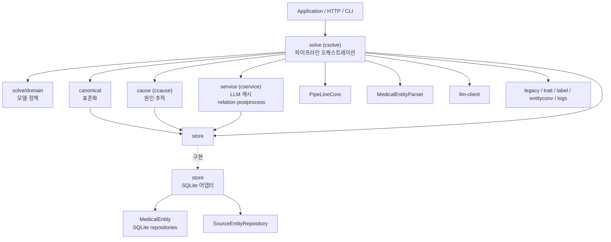
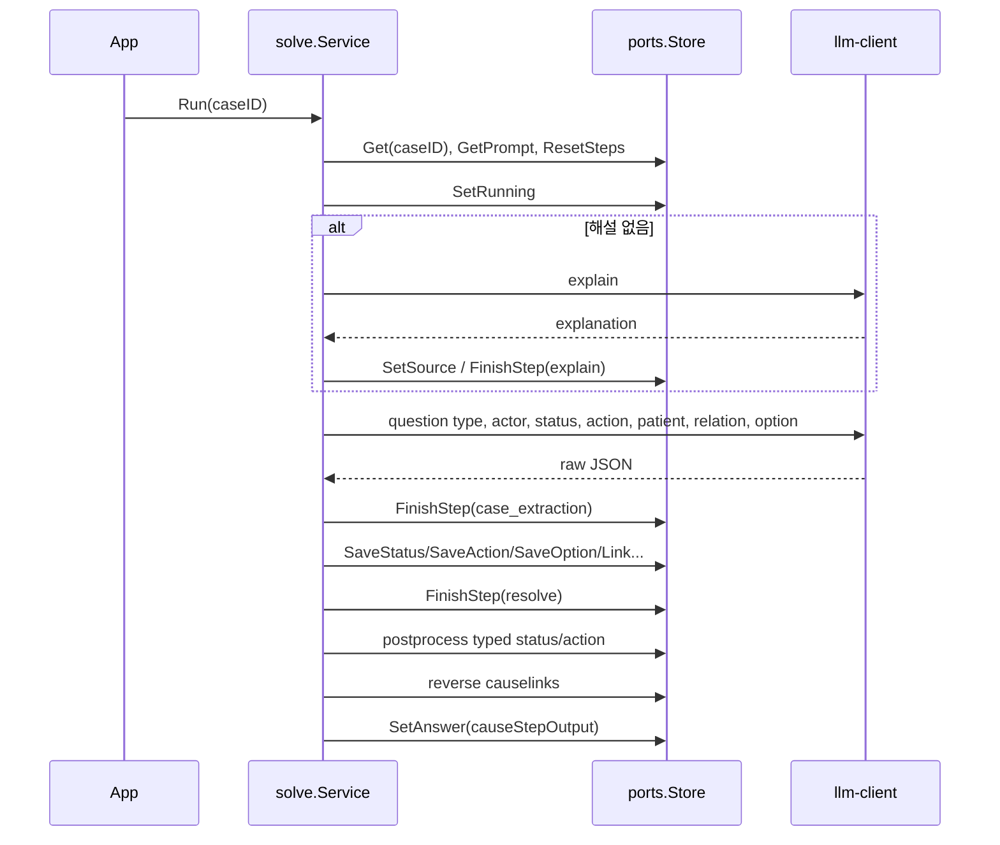

# 아키텍처

## 목적

MorbesPipeline은 하나의 의학 문제 풀이 case를 다음 순서로 처리한다.

1. 문제/정답/해설을 확보한다.
2. 문제 본문만 근거로 임상 소견, 행동, 관계, 환자 서술, 치료 선택지를 추출한다.
3. 추출된 draft를 MedicalEntity 표준 엔티티로 canonicalize하여 저장한다.
4. 저장된 상태/행동 인과 링크에서 관찰된 상태의 원인 후보를 추적한다.
5. 추적 결과를 case의 답으로 확정한다.

## 계층



### 계층별 책임

| 계층 | 패키지 | 책임 |
| --- | --- | --- |
| 도메인 | `internal/domain/*` | Case, Step, Stage, 질문 유형/정책, 프롬프트 메타데이터 |
| 영속 모델 | `internal/domain/solve/model` | `LLMCall`, `LLMCallInput`, `PromptVersion` |
| 애플리케이션 | `internal/pipeline` | 노드 파이프라인, LLM 단계, typed draft→resolved 변환, replay |
| 도메인 서비스 | `internal/tracing/cause`, `internal/domain/*` | 원인 추적, 구조 변환, 라벨 |
| 어댑터 | `internal/store` | SQLite 저장소, postprocess audit, 테이블 관리 |
| 공유 커널 | `internal/domain/trait`, `internal/domain/label`, `internal/support/*` | trait 규칙, 라벨, 로깅 |
| 외부 연동 | `MedicalEntityParser`, `PipeLineCore`, `SourceEntity*`, `SQLCore`, `log-sqlite`, `llm-client` | 직접 import |

## 의존 방향

```text
internal/pipeline ──► internal/domain
internal/pipeline ──► internal/tracing/cause ──► MedicalEntityRepository/repo
internal/pipeline ──► internal/store
internal/store ──► MedicalEntityRepository/repo
internal/store ──► SourceEntityRepository
```

- `internal/tracing/cause`는 `ActionsResultingInStatus`,
  `StatusesCausingAction`, `ActorsCausingAction`만 사용한다.
- `internal/store`가 SQLite row와 numeric ID를 소유한다. 파이프라인은 typed value를
  사용하고, numeric ID는 store 내부에서만 조회한다.
- postprocess는 현재 case의 typed status/action을 대상으로 동작하며, audit row는
  `morbes_postprocesses`에 기록한다.

## 외부 모듈

| 모듈 | 사용 목적 |
| --- | --- |
| `github.com/G226Medi03/PipeLineCore` | 노드/파이프라인 실행 엔진 (`core.Pipeline`, `core.State`) |
| `github.com/G226Medi03/MedicalEntity` | 표준 의료 엔티티, ename 타입, codec, SQLite repository |
| `github.com/G226Medi03/MedicalEntityParser` | LLM 출력 파싱, status/action/procedure 정규화 |
| `github.com/G226Medi03/SourceEntity` | source 추적 ID와 LLM 응답 레코드 |
| `github.com/G226Medi03/llm-client` | LLM 호출 클라이언트 |
| `github.com/G226Medi03/log-sqlite` | SQLite 로깅 |
| `github.com/G226Medi03/SQLCore` | SQLite 유틸리티 (`store`에서 사용) |

## 핵심 설계 원칙

### 1. 문제 본문과 정답/해설의 분리

- 질문 유형 분류와 소견 추출은 `problem_stem`(선택지 제거) 또는 문제 본문만 본다.
- 정답/해설 사용 금지 지시는 `MorbesLLMService`가 소유한 prompt template에 포함한다.
- 정답은 파이프라인 실행 중 후보 선택에 사용하지 않는다. 선택 로직은
  `SelectMedicalProcedureOption`처럼 문제와 저장된 인과 근거만 사용한다.

### 2. Draft → Resolve 2단계

LLM은 이름/값 중심의 draft를 만든다. `resolve` 단계에서만 저장소를 호출해
ID를 부여하고, 그래프 연결을 만든다. 따라서 LLM 호출과 영속화가 분리되고,
resolve 이전 단계는 replay/재실행이 쉽다.

### 3. 체크포인트 기반 재개

각 주요 노드는 `solve_steps`에 `output_json`을 남긴다. `fromNode`로 재개하면
이전 단계는 체크포인트를 읽고, 하위 단계는 `stale`로 표시한 뒤 다시 실행한다.

### 4. LLM 응답 캐시와 Source 추적

- `llm_responses`에 모델/프롬프트/참조 source 기준으로 응답을 캐시한다.
- 각 엔티티와 LLM 호출은 `source_id`로 근거를 추적한다.
- `LLMCacheUse`, `LLMCacheRefresh`, `LLMCacheBypass` 세 모드가 있다.

### 5. 재현 가능한 replay

- LLM replay: 같은 case를 초기화하고 LLM을 다시 호출한다(캐시 사용 가능).
- Code replay: 저장된 `solve_llm_calls.raw_output`을 프롬프트/단계 기준으로
  재생한다. 특정 단계만 live LLM으로 override할 수 있다.

### 6. 표준 ID만 저장

canonicalize된 status/action/procedure는 이름 대신 ID를 저장한다. 예를 들어
`have_disease`는 `disease_id`, `received_medical_procedure`는 `procedure_id`를
갖는다. 라벨은 조회 시 `label` 패키지가 다시 만든다.

## 전체 실행 흐름



## 관련 문서

- 노드/재개/replay 세부: [pipeline.md](pipeline.md)
- 프롬프트와 추출 결과: [extraction-llm.md](extraction-llm.md)
- 모델과 상태/행동/시술: [domain-model.md](domain-model.md)
- 저장소 구현: [persistence.md](persistence.md)
